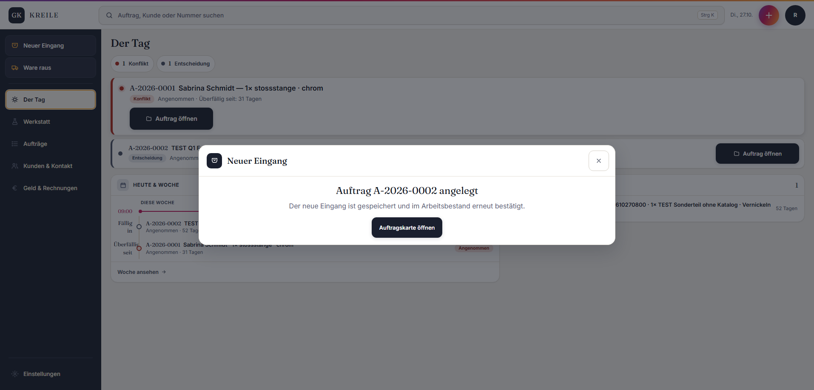

# Abgabe Q01 – Katalog oder Freitext

Status: **PASS**
Branch: `kreile/s1-p2-eingang`
Geprüfter Produkt-SHA: `36e1c402ec4fa7db116e599f641e329ba04bf018`
Preview: <https://galvanik-kreile-werkstatt-531saf6rs.vercel.app>

## Geändert

- Eingang, „Teil hinzufügen“ und KV akzeptieren eine Katalogleistung oder eine freie Positionsbezeichnung.
- Die Oberfläche ist eine eigene Auswahl; ein leerer Katalog sperrt den Freitextweg nicht.
- Freitextpositionen werden ohne erfundene Katalog-, Preis-, Einheits- oder MwSt.-Werte gespeichert.
- Das Wareneingangs-Audit verwendet die vertraglich gebundene Event-Station `wareneingang`; der Auftrag startet weiter in `angenommen`.
- Die Dev-DB enthält die additiven Q1-View-Migrationen `20261027074500` und `20261027075500`; bestehende Daten wurden nicht umgeschrieben.

## Prüfschritt

**PASS am 27.10.2026:** Als Rolf in der Preview angemeldet, `TEST Q1 Freitext 202610270800` als Neukunde angelegt, Position `TEST Sonderteil ohne Katalog` mit Oberfläche `Vernickeln` erfasst und Auftrag `A-2026-0002` gebucht.

SQL-Nachweis gegen die echte Dev-DB: genau ein Treffer in `orders`, dazu `item_rows = 1`, `catalog_service_id IS NULL = true`, Oberfläche `Vernickeln`; Order-ID `bde06276-639f-4693-b1e3-9dca0a2778d6`.

Lokal grün: 29 fokussierte Tests, ESLint der geänderten TypeScript-Dateien und `tsc --noEmit --incremental false`.

## Neuer Fund – nur ans Queue-Ende

Der zusätzliche Klick auf „Auftragskarte öffnen“ meldete nach der bereits erfolgreichen Buchung „Auftragskarte nicht verfügbar“. Das ist nicht Teil des definierten Q1-Prüfschritts und wurde nicht vorgezogen. Fehlversuche haben ausschließlich eindeutig mit `TEST` bezeichnete Kunden hinterlassen; es wurde nichts gelöscht.
