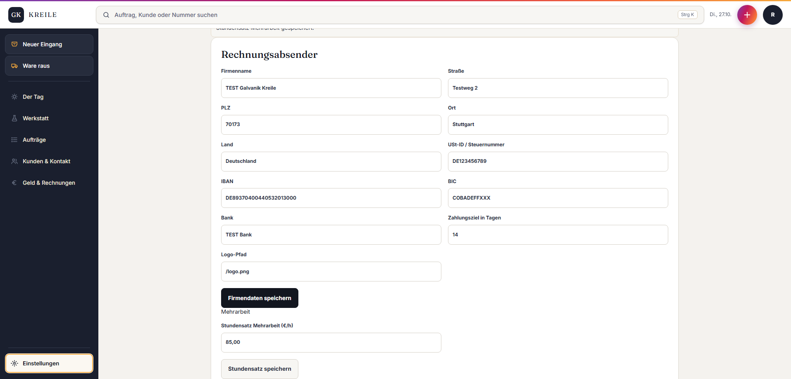

# Abgabe Q02 – Ersteinrichtung

Status: **PASS**  
Branch: `kreile/s1-p2-eingang`  
Geprüfter Produkt-SHA: `7b1a485b3a502688043dbb585504a30cbc43fb7e`  
Preview: <https://galvanik-kreile-werkstatt-3c6tms1sr.vercel.app>

## Geändert

- Geführter Dreischritt: Firmendaten → Leistung mit Preis in Euro → Stundensatz.
- Nach erfolgreichem Speichern öffnet sich jeweils der nächste Schritt.
- Firmendaten- und Stundensatz-Sperren verlinken zur richtigen Einstellung; `returnTo` führt danach zum Ausgangsvorgang zurück.

## Prüfschritt

**PASS:** Als Rolf vollständig durchgeklickt. Gespeichert wurden `TEST Galvanik Kreile`, Leistung `TEST Q2 Vernickeln` zu 42,50 € netto und Mehrarbeits-Stundensatz 85,00 €.

SQL gegen die echte Dev-DB: `company_settings = 1`, `catalog_services = 1`, `extra_work_hourly_rates = 1`, Leistungspreis `4250` Cent, Stundensatz `8500` Cent.

## Owner-Abnahme (5 Minuten)

Preview: <https://galvanik-kreile-werkstatt-3c6tms1sr.vercel.app> · Rolle: Rolf

1. Als Rolf anmelden und „Einstellungen“ öffnen → oben ist der Dreischritt „Firmendaten / Leistung mit Preis / Stundensatz“ sichtbar.
2. „Firmendaten“ öffnen → die gespeicherten TEST-Firmendaten sind sichtbar.
3. „Leistungskatalog“ öffnen → `TEST Q2 Vernickeln` zeigt 42,50 €.
4. Zurück zu „Firmendaten“ → „Stundensatz Mehrarbeit“ zeigt 85,00 €.
