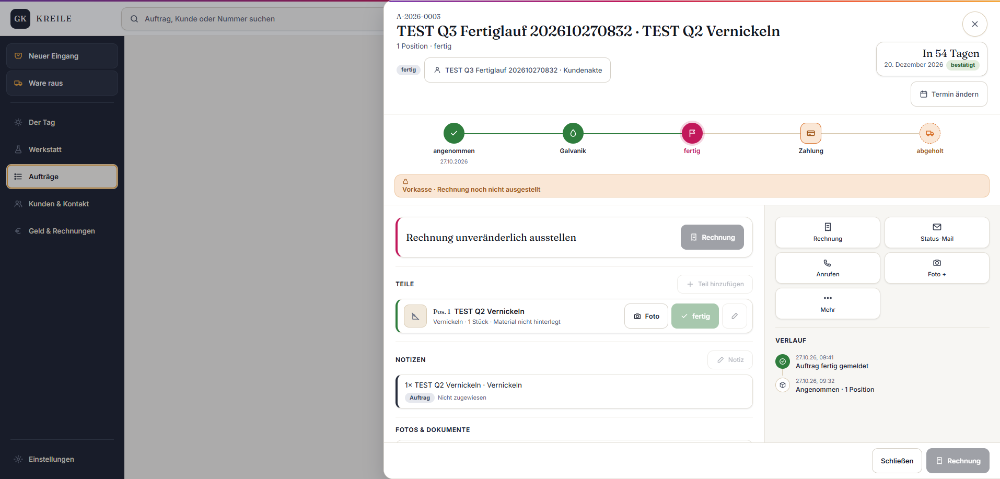

# Abgabe Q03 – Teil und Auftrag fertig

Status: **PASS**  
Branch: `kreile/s1-p2-eingang`  
Geprüfter Produkt-SHA: `57592c54a225df9732c78f4c37e678febbf02a78`  
Preview: <https://galvanik-kreile-werkstatt-h9wjsnljj.vercel.app>

## Geändert

- Ein bereits als `fertig` markiertes Teil blockiert das Fertigmelden des Auftrags nicht mehr.
- Beim Freeze werden nur noch Teile in `galvanik` umgestellt; bereits fertige Teile bleiben unverändert.
- Der Stationswechsel-Vertrag akzeptiert für neue Ereignisse die kanonische Ausgangsstation `angenommen`; die Receipt-Views lesen zusätzlich historische `wareneingang`-Ereignisse weiter.

## Prüfschritt

**PASS:** Als Rolf den TEST-Auftrag `A-2026-0003` vollständig durchgeklickt: In Galvanik → Teil fertig → Fertig melden.

SQL gegen die echte Dev-DB: `station = fertig`, `status = fertig`, `item_station = fertig`, `order_freezes = 1`.

Die additive Migration `20261027083455_q3_angenommen_station_contract.sql` ist lokal vollständig replayt und in der Dev-DB angewendet. Die bereits vor Q03 remote vorhandene P3-Migration `20261026200000` bleibt als bekannte Remote-vor-Branch-Abweichung unverändert.

## Owner-Abnahme (5 Minuten)

Preview: <https://galvanik-kreile-werkstatt-h9wjsnljj.vercel.app> · Rolle: Rolf

1. Als Rolf anmelden und Auftrag `A-2026-0003` öffnen.
2. Oben muss der Auftragsstatus `fertig` sichtbar sein.
3. In der Position muss das Teil grün als `fertig` markiert sein.
4. Im Verlauf muss `Auftrag fertig gemeldet` stehen.

## Neuer Fund außerhalb Q03

Der Datenbank-Advisor meldet bei 26 öffentlichen Legacy-Tabellen deaktiviertes RLS. Es wurde nichts automatisch geändert, weil dafür tabellenspezifische Policies und eine gesonderte Produkt-/Sicherheitsentscheidung nötig sind.
