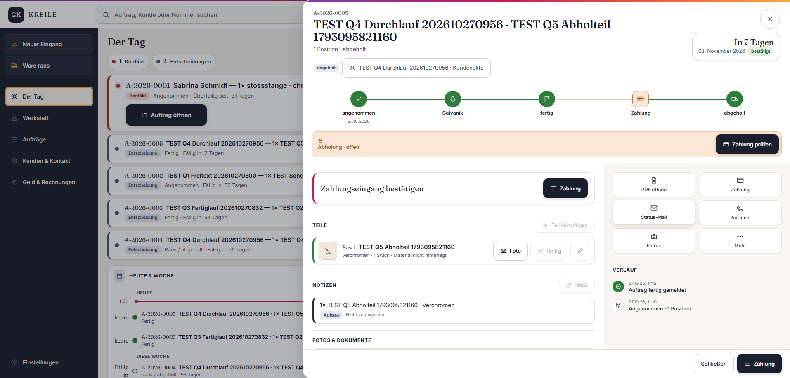

# Abgabe Q05 · Zahlungsart und Übergabe aus dem Eingang

Status: **PASS**  
Branch: `kreile/s1-p2-eingang`  
Geprüfter Produkt-SHA: `a6b844f21c21eedd4c03928a9f131f4e29dfc3e0`  
Preview: <https://galvanik-kreile-werkstatt-gj5xfjho1.vercel.app>  
Vercel-Deployment: `dpl_9uXjHYpi96qKimEaiJ2fr14UHs3y` · Ready · Funktionen `fra1`

## Neu gemacht

- Der Dialog `Neuer Eingang` übergibt die gewählte Zahlungsart und Übergabe als explizite Auftragswerte.
- `Bar oder Karte bei Abholung` wird als `payment_mode = abholung` gespeichert; der Auftrag fällt nicht mehr still auf Vorkasse zurück.
- Die Übergabe wird als `handover_mode = pickup | shipping` am Auftrag und im unveränderlichen Eingangsereignis belegt.
- Bei `Bar oder Karte bei Abholung` ist `Ware raus` nach ausgestellter Rechnung auch vor der Zahlungsbestätigung erlaubt. Vorkasse bleibt bis zur vollständigen Zahlung gesperrt.
- Der Kundenabgleich des Eingangs sendet nur den gebundenen Kundenvertrag; ein internes UI-Feld blockiert den vorhandenen Kunden nicht mehr.
- Die Auftragskarte verwendet für den sichtbaren Warenausgang dieselbe Abholungsfreigabe wie der Serververtrag.

## Preview-Klicktest

Rolle: Rolf. Reales TEST-Objekt: Auftrag `A-2026-0005`.

1. `Neuer Eingang` geöffnet, TEST-Kunde gewählt, Übergabe `Abholung` und Zahlungsart `Bar oder Karte bei Abholung` eingestellt.
2. Freitextposition `TEST Q5 Abholteil 1793095821160` angelegt und den Eingang gebucht. Die Bestätigung zeigte Auftrag `A-2026-0005`, `Übergabe: Abholung` und `Zahlungsart: Bar oder Karte bei Abholung`.
3. Auftrag über `In Galvanik` → Teil `fertig` → `Fertig melden` geführt und die Rechnung mit 75,00 € netto ausgestellt.
4. Ohne eine Zahlung zu bestätigen `Ware raus` ausgeführt. Die Auftragskarte zeigt `abgeholt`, während die Zahlung weiterhin `Abholung · offen` ist.



## Datenbank-Nachweis

Live-Abfrage gegen die echte Dev-DB für Auftrag `A-2026-0005` nach dem Klicktest:

```text
order_number=A-2026-0005
payment_mode=abholung
handover_mode=pickup
station=abgeholt
status=abgeholt
version=5
payment_status=offen
payment_paid_amount_cents=0
payment_open_amount_cents=8925
goods_out_events=1
```

Remote angewandt und belegt:

- `20261026200000_s1_p3_termintreue_kalender` (bereits remote vorhanden; lokale Historie wiederhergestellt)
- `20261027113000_q5_intake_payment_handover`

Die Migrationsliste ist für beide Versionen lokal = remote. Der lokale Fresh-Replay konnte nicht gestartet werden, weil Docker den bereits belegten lokalen Port `54322` nicht binden konnte. Das Umgebungsproblem wurde innerhalb der 30-Minuten-Grenze beendet; die additive Q05-Migration ist in der echten Dev-DB angewandt.

## Prüfungen

- TypeScript: PASS
- ESLint der geänderten TypeScript-Dateien: PASS
- Zieltests Eingang, Readback, Zahlungsübersicht und Warenausgang: 26/26 PASS
- Lokaler Produktionsbuild vor der letzten UI-Gate-Korrektur: PASS; Vercel-Build am Produkt-SHA: Ready
- Preview-Klicktest und SQL-Zeile: PASS
- GitHub-CI wird gemäß Spielregel 4c nicht abgewartet; ein später roter Pflichtcheck hat Vorrang vor Q06.

## Abweichungen / Rest

- Keine Echtdaten verändert: Der Nachweis verwendet ausschließlich klar bezeichnete TEST-Daten in der Entwicklungsdatenbank.
- Der lokale Fresh-Replay blieb am belegten Docker-Port hängen; Preview, Remote-Migration und SQL-Nachweis sind davon nicht betroffen.

## Owner-Abnahme (5 Minuten)

Preview: <https://galvanik-kreile-werkstatt-gj5xfjho1.vercel.app> · Rolle: **Rolf**

1. Als Rolf anmelden und Auftrag `A-2026-0005` öffnen → Kopf und Ortskette zeigen `abgeholt`.
2. In der orangefarbenen Zahlungsschwelle steht `Abholung · offen` → es wurde keine Zahlung vorgetäuscht.
3. Im Rechnungsblock steht der offene Rechnungsbetrag; `PDF öffnen` ist sichtbar.
4. Im Tagesstand bleibt `A-2026-0005` als fertiger TEST-Abholauftrag auffindbar.
