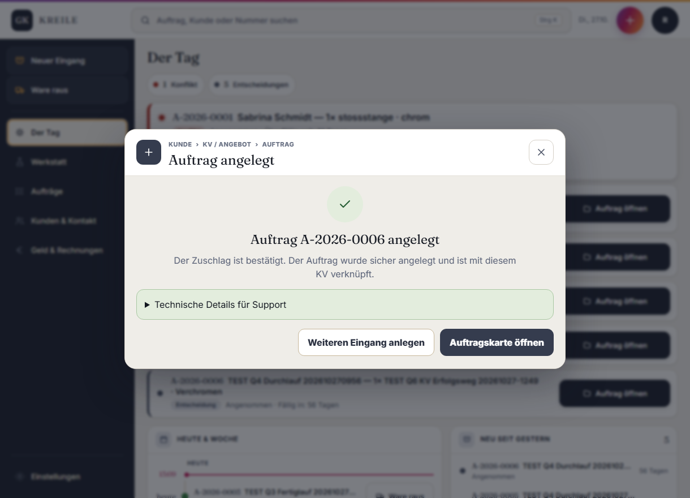

# Abgabe Q06 · KV → Auftrag

Status: **PASS**

Branch: `kreile/s1-p2-eingang`

Geprüfter Produkt-SHA: `7a6036557b4f130d6f48d0898d6aaddccfbc19e2`

Preview: <https://galvanik-kreile-werkstatt-1lpqpvsal.vercel.app>

Vercel-Deployment: `dpl_7MBVXQ2Yx6dovrKn1ta4BuV7NFMK` · Ready · Funktionen `fra1`

## Neu gemacht

- Der Zuschlag eines gespeicherten Kostenvoranschlags übergibt Termin, Übergabe und Zahlungsart vollständig an den vorhandenen Auftragseingang.
- KV-Freitextpositionen werden mit dem vollständigen, vom Auftragseingang verlangten Positionsvertrag weitergereicht.
- KV-Konvertierung und Auftragseingang verwenden denselben vollständigen Intent-Hash; der Trigger prüft zusätzlich Übergabe und Zahlungsart am gespeicherten Auftrag.
- Eine vorbereitete Konvertierung kann nach einem unterbrochenen Auftragseingang mit derselben Anfragekennung idempotent fortgesetzt werden.
- Offener KV und Konvertierungskennung werden gemeinsam in der Sitzung gemerkt. Nach einem Neustart zeigt `Gespeicherten KV fortsetzen` bei bereits erzeugtem Auftrag direkt den sicheren Konvertierungsbeleg.
- Die Readback-View prüft das vollständige Q5-Ereignispayload und bestätigt nur einen wirklich verknüpften Auftrag.

## Preview-Klicktest

Rolle: Rolf. Reale TEST-Objekte: `KV-2026-0002` und Auftrag `A-2026-0006`.

1. `Neuer Eingang` geöffnet, Art `KV`, bestehenden vollständigen TEST-Kunden und Freitextposition `TEST Q6 KV Erfolgsweg 20261027-1249` mit 125,00 € netto gewählt.
2. KV gespeichert und den Link `KV als PDF` geladen: HTTP 200, `content-type: application/pdf`.
3. Zugesagten Termin `22.12.2026`, Übergabe `Versand` und Zahlungsart `Vorkasse` gewählt; `Zuschlag bestätigen · Auftrag anlegen` geklickt.
4. Die Wiederaufnahme mit derselben Anfragekennung zeigt `Auftrag A-2026-0006 angelegt` und bestätigt die sichere Verknüpfung mit dem KV.



## Datenbank-Nachweis

Vor Q06: `quotes=0`, `orders=5`. Nach dem Klicktest: `quotes=2`, `orders=6`. Der erfolgreiche Prüfvorgang selbst hat genau einen Auftrag ergänzt:

```text
quote_number=KV-2026-0002
quote_status=converted
quote_version=2
order_number=A-2026-0006
handover_mode=shipping
payment_mode=vorkasse
due_date=2026-12-22
station=angenommen
order_status=angenommen
order_items=1
conversion_receipt_integrity=true
```

Remote angewandt und lokal = remote:

- `20261027113511_q6_quote_conversion_retry`
- `20261027115340_q6_quote_conversion_event_contract`
- `20261027115757_q6_quote_conversion_readback_contract`

Alle drei Migrationen ersetzen ausschließlich private Funktion/View-Verträge. Sie löschen oder ändern keine Fachzeile.

## Prüfungen

- TypeScript: PASS
- ESLint der geänderten TypeScript-Dateien: PASS
- Zieltests KV-Befehl und globaler KV-Ablauf: 20/20 PASS
- Pre-Commit-Gesamtlauf: 134 Testdateien, 1053/1053 Tests PASS
- Supabase Dry-Run: genau die jeweils erwartete Migration, keine Seeds oder Rollenänderungen
- Supabase DB Advisors (`error`): keine Befunde
- Vercel-Build: Ready
- Preview-Klicktest, PDF und SQL-Readback: PASS
- GitHub-CI wird gemäß Spielregel 4c nicht abgewartet; ein später roter Pflichtcheck hat Vorrang vor Q06b.

## Abweichungen / Rest

- Der erste Diagnoseversuch legte `KV-2026-0001` als klar bezeichneten TEST-KV an, bevor die drei voneinander abhängigen Altverträge vollständig sichtbar waren. Dieser KV bleibt entsprechend der Vorgabe „nichts löschen“ als offener TEST-Entwurf erhalten; er ist mit keinem Auftrag verknüpft.
- Keine Echtdaten verändert. Alle fachlichen Schreibvorgänge erfolgten über die Preview als Rolf; remote wurden ausschließlich additive Migrationen angewandt.

## Owner-Abnahme (5 Minuten)

Preview: <https://galvanik-kreile-werkstatt-1lpqpvsal.vercel.app> · Rolle: **Rolf**

1. Als Rolf anmelden und `Neuer Eingang` öffnen → oben erscheint `Gespeicherten KV fortsetzen`.
2. `Gespeicherten KV fortsetzen` klicken → sichtbar ist `Auftrag A-2026-0006 angelegt` und der Hinweis, dass der Auftrag sicher mit dem KV verknüpft ist.
3. `Auftragskarte öffnen` klicken → die Karte von `A-2026-0006` öffnet sich mit Station `angenommen`.
4. In der Karte Übergabe/Zahlung prüfen → `Versand` und `Vorkasse` sind am Auftrag gebunden.
