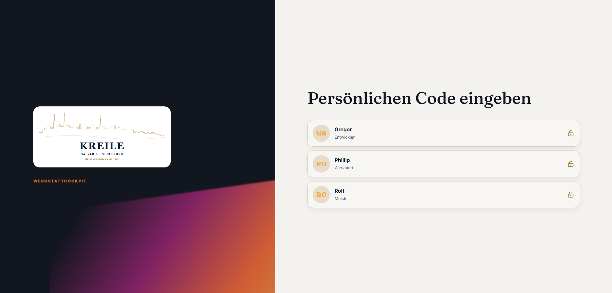

# Abgabe Q07 · Nutzer als eine Wahrheit

Status: **PASS**

Branch: `kreile/s1-p2-eingang`

Geprüfter Produkt-SHA: `9ecc67ba74bc6c255a01d940ae9af36b7e67ba68`

Preview: <https://galvanik-kreile-werkstatt-f3nrrko2l.vercel.app>

Vercel-Deployment: `dpl_97ny1oPbh4yL2wehBsA8ZeooCWa9` · Ready · Funktionen `fra1`

## Neu gemacht

- `/start` liest alle und nur die aktiven Nutzer aus `app_users`; Namen, Rollen und PIN-Anmeldung verwenden damit dieselbe Datenwahrheit.
- Jeder aktive Nutzer mit gültiger Rolle und vorhandener PIN erhält genau eine Startkachel. Interne IDs, E-Mail-Adressen und PIN-Hashes verlassen den Server nicht.
- Die Anmeldung ist nicht mehr auf drei fest codierte Personen begrenzt und übernimmt Anzeigename und Rolle aus der bestätigten Datenbankzeile.
- `developer` ist in der Rollenpflege auswählbar. Neue PINs müssen genau vier Ziffern haben.
- Selbstdeaktivierung, Deaktivierung des letzten aktiven Nutzers und Entfernung des letzten aktiven Managers werden serverseitig verhindert.
- `sabrina schmidt`, `Christian Dieter` und `Reiner Schmitt` wurden über die Preview auf inaktiv gesetzt. Es wurden keine Nutzer angelegt oder gelöscht.

## Preview-Klicktest

Rolle: Rolf.

1. Auf `/start` als Rolf angemeldet und `Einstellungen` → `Nutzer & Rollen` geöffnet.
2. `sabrina schmidt`, `Christian Dieter` und `Reiner Schmitt` jeweils deaktiviert und einzeln erfolgreich gespeichert.
3. Gregors bestehende Zeile mit Rolle `developer` und Status aktiv unverändert erfolgreich gespeichert.
4. Sitzung geleert und `/start` neu geladen.
5. Ergebnis: exakt drei Startkacheln — Gregor · Entwickler, Phillip · Werkstatt, Rolf · Meister.



## Datenbank-Nachweis

```text
active_count=3
active_users=Gregor(developer), Phillip(werkstatt), Rolf(meister)
all_active_users_have_pin=true
inactive_users=Christian Dieter, Reiner Schmitt, sabrina schmidt
start_tile_count=3
```

Damit gilt: Menge aktive Nutzer = Menge Startkacheln = `3`.

## Prüfungen

- Zieltests Startseite, PIN-Anmeldung, Auth-Bootstrap und Nutzerpflege: 26/26 PASS.
- TypeScript: PASS.
- ESLint der geänderten TypeScript-Dateien: PASS.
- Vercel: PASS / Ready am Produkt-SHA, Funktionen in `fra1`.
- Realer Preview-Klicktest und separater SQL-Readback: PASS.
- GitHub-`agentur-gate` wurde gemäß Spielregel 4c nicht abgewartet; ein später roter Pflichtcheck hat Vorrang vor Q08.

## Abweichungen / Rest

- Keine Abweichung vom Q07-Auftrag festgestellt.
- Keine neue Nutzeranlage und keine Änderung des Auth-/Sessionmodells.

## Owner-Abnahme (5 Minuten)

Preview: <https://galvanik-kreile-werkstatt-f3nrrko2l.vercel.app>

1. `/start` öffnen. Erwartung: exakt drei Kacheln für Gregor, Phillip und Rolf.
2. Als Rolf anmelden → `Einstellungen` → `Nutzer & Rollen`. Erwartung: Christian Dieter, Reiner Schmitt und sabrina schmidt sind inaktiv; Gregor ist aktiv und hat Rolle Entwickler.
3. Gregors Zeile ohne Änderung speichern. Erwartung: `Gregor gespeichert.`
