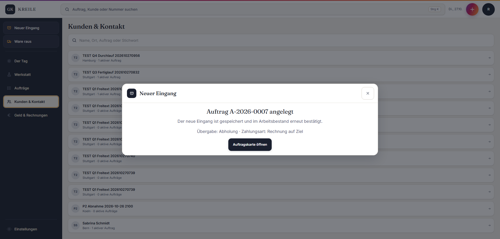

# Abgabe Q08 · Altkunde ohne Kundennummer

Status: **PASS**

Branch: `kreile/s1-p2-eingang`

Geprüfter Produkt-SHA: `f1a68edfea18ab3caa0d1621a09490b1cada73f6`

Preview: <https://galvanik-kreile-werkstatt-19mxywysa.vercel.app>

Vercel-Deployment: `dpl_43csNmKguXH8ghZRUZavHULXbTvB` · Ready · Funktionen `fra1`

## Neu gemacht

- Beim Vervollständigen eines Altkunden ohne Kundennummer vergibt der vorhandene Nummernkreis atomar genau eine kanonische Nummer.
- Bereits vorhandene Kundennummern bleiben unverändert.
- Der sichere Readback bestätigt nach dem Speichern zusätzlich, dass die Kundennummer vorhanden ist.
- `Neuer Auftrag` aus der Kundenkarte öffnet den vorhandenen Eingang mit genau diesem Kunden vorausgewählt.
- Neue Migration `20261027140000_q8_assign_legacy_customer_number.sql` ersetzt nur den bestehenden privaten Schreibvertrag; keine Fachzeile wurde gelöscht.

## Preview-Klicktest

Rolle: Rolf.

1. Kundenkarte `Sabrina Schmidt` geöffnet; Ausgangszustand war `Ohne Kundennummer`.
2. Vorhandene vollständige Stammdaten über `Bearbeiten` → `Stammdaten speichern` bestätigt.
3. Kundenkarte zeigte danach `K-2026-0011`.
4. `Neuer Auftrag` geklickt; `Sabrina Schmidt · K-2026-0011` war im Eingang vorausgewählt.
5. Freitextposition `TEST Q8 Altkunde Auftrag` mit Oberfläche `Vernickeln` gebucht; Ergebnis: `Auftrag A-2026-0007 angelegt`.



## Datenbank-Nachweis

```text
customer_id=bb526bfa-8a42-4407-9300-06d90cf7410a
customer_number=K-2026-0011
customer_name=Sabrina Schmidt
order_id=78440bd2-7a0b-408b-9f26-7ba32b187db1
order_number=A-2026-0007
station=angenommen
item_name=TEST Q8 Altkunde Auftrag
surface_requested=Vernickeln
```

Remote-Migrationen = Repo bis einschließlich `20261027140000`.

## Prüfungen

- TypeScript: PASS.
- Zieltests Globaler Eingang und Kundenkarte: 20/20 PASS.
- ESLint der geänderten TypeScript-Dateien: PASS.
- Supabase Remote-Dry-Run: exakt eine Migration, keine Seeds oder Rollenänderungen.
- Supabase Remote-Apply und anschließende Migrationsliste: Repo = Remote.
- Vercel: PASS / Ready am Produkt-SHA, Funktionen in `fra1`.
- Realer Preview-Klicktest und separater SQL-Readback: PASS.
- GitHub-`agentur-gate` wurde gemäß Spielregel 4c nicht abgewartet; ein später roter Pflichtcheck hat Vorrang vor Q09.

## Abweichungen / Rest

- Der lokale Supabase-Fresh-Replay konnte nicht gestartet werden, weil Windows den konfigurierten lokalen Port `54322` nicht freigab. Nach der 30-Minuten-Werkzeugregel wurde nicht an Docker oder fremden Diensten manipuliert; SQL-Dry-Run, Remote-Apply und der echte Preview-/SQL-Nachweis waren grün.

## Owner-Abnahme (5 Minuten)

Preview: <https://galvanik-kreile-werkstatt-19mxywysa.vercel.app> · Rolle: **Rolf**

1. Als Rolf anmelden → `Kunden & Kontakt` → `Sabrina Schmidt`. Erwartung: Kundenkarte zeigt `K-2026-0011`.
2. `Neuer Auftrag` klicken. Erwartung: `Sabrina Schmidt · K-2026-0011` ist im Feld Kunde vorausgewählt.
3. Der vorhandene Prüfauftrag ist in der Kundenkarte als aktiver Auftrag `A-2026-0007` sichtbar.
