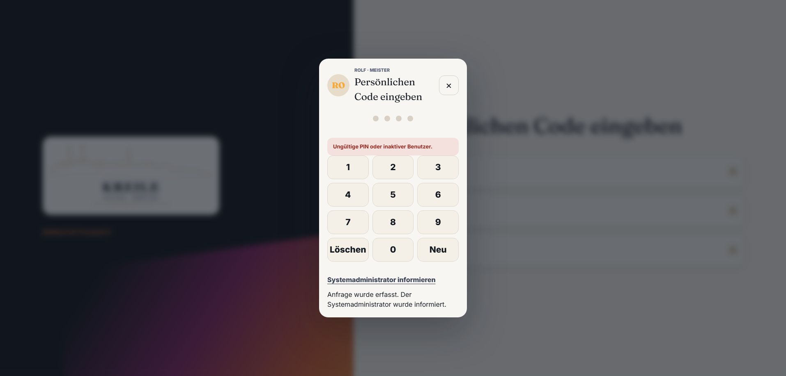

# Abgabe Q09 · Kleine Sackgassen

Status: **PASS**

Branch: `kreile/s1-p2-eingang`

Geprüfter Produkt-SHA: `bcca55f240c260c715641aa8eb45f42260c5ba3b`

Preview: <https://galvanik-kreile-werkstatt-otsep6e5o.vercel.app>

Vercel-Deployment: `dpl_26NcCBJHexAhovQYdEXdDQcd1bZ1` · Ready · Funktionen `fra1`

## Neu gemacht

- Gregors Rolle `developer` zeigt alle freigegebenen Bereiche und die vollständigen Einstellungen.
- `Ware raus` öffnet `/orders?station=fertig`; die Auftragsliste übernimmt den URL-Filter und markiert `Fertig` aktiv.
- `Kunde anlegen` öffnet direkt das bestehende Neukundenformular statt des Auftragseingangs.
- Der Stufen-Schalter ist ausgeblendet, solange er keine reale Produktoberfläche steuert. Die serverseitige Feature-Wahrheit bleibt erhalten.
- `Systemadministrator informieren` zeigt nach dem Serverergebnis eine eindeutige sichtbare Rückmeldung.
- Der ungenutzte `MockAppFrame`, sein ausschließlich daran gebundener Kontext und der tote Mock-Test wurden entfernt.

## Preview-Klicktest

1. Als Gregor angemeldet: Der Tag, Werkstatt, Aufträge, Kunden & Kontakt, Geld & Rechnungen und Einstellungen waren sichtbar; `Stufen-Schalter` war nicht sichtbar.
2. Als Rolf `Ware raus` geklickt: URL `/orders?station=fertig`, Segment `Fertig` aktiv.
3. Globales Plus → `Kunde anlegen` geklickt: Dialogüberschrift `Neukunde erfassen` sichtbar.
4. Auf `/start` bei Rolf absichtlich eine falsche PIN eingegeben und `Systemadministrator informieren` geklickt: `Anfrage wurde erfasst. Der Systemadministrator wurde informiert.` sichtbar.



## Datenbank-Nachweis

```text
ui_events.id=n35t293nhtqc8n4c7iu3p0wi
event_type=pin_reset_requested
user_name=Rolf
created_at=2026-10-27T13:09:20.526Z
```

## Prüfungen

- TypeScript: PASS.
- Zieltests Einstellungen, Startseite und Auftragsliste: 17/17 PASS.
- ESLint der geänderten TypeScript-Dateien: PASS.
- Vercel: PASS / Ready am Produkt-SHA, Funktionen in `fra1`.
- Realer Preview-Klicktest aller fünf Q09-Stellen und separater SQL-Readback: PASS.
- Keine Migration; Remote-Migrationen = Repo bis einschließlich `20261027140000`.
- GitHub-`agentur-gate` wurde gemäß Spielregel 4c nicht abgewartet; ein später roter Pflichtcheck hat Vorrang vor Q10.

## Abweichungen / Rest

- Keine Abweichung vom Q09-Auftrag festgestellt.

## Owner-Abnahme (5 Minuten)

Preview: <https://galvanik-kreile-werkstatt-otsep6e5o.vercel.app>

1. Als Rolf anmelden → `Ware raus`. Erwartung: Aufträge öffnen, Filter `Fertig` ist aktiv.
2. Globales Plus → `Kunde anlegen`. Erwartung: `Neukunde erfassen` öffnet sich.
3. Neu auf `/start` → Rolf → einmal falsche PIN → `Systemadministrator informieren`. Erwartung: sichtbarer Text `Anfrage wurde erfasst. Der Systemadministrator wurde informiert.`
4. Als Gregor anmelden. Erwartung: alle sechs freigegebenen Bereiche sind sichtbar; in Einstellungen gibt es keinen wirkungslosen `Stufen-Schalter`.
